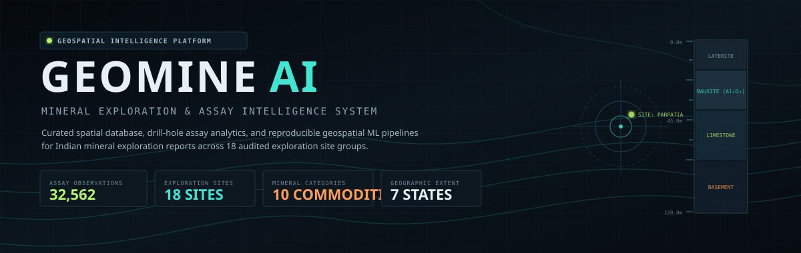
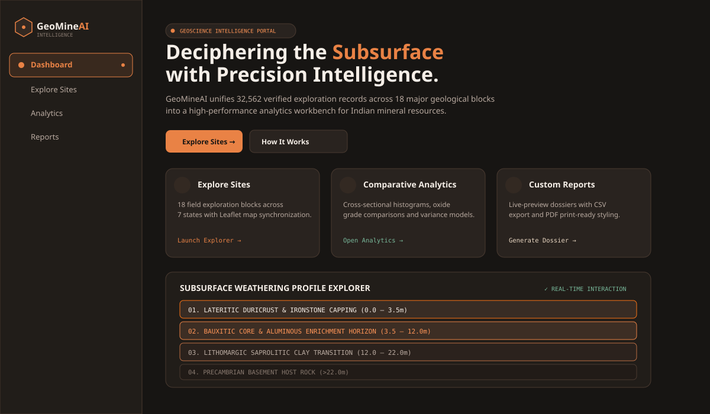
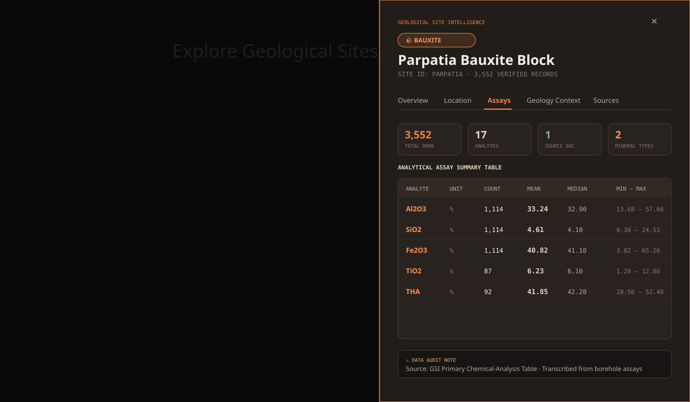
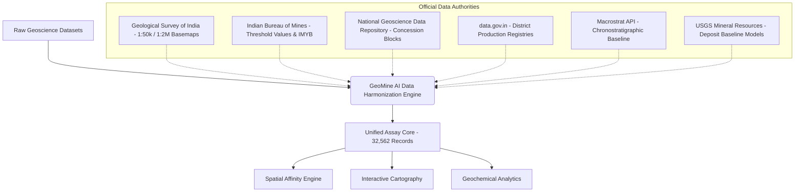

# GeoMine AI

<p align="center">
  
</p>

<p align="center">
  <strong>Deciphering the Subsurface with Precision Geoscience Intelligence</strong><br>
  <em>An AI-powered mineral exploration intelligence portal unifying fragmented geological records, source-verified assay datasets, and geospatial exploration blocks for India's mineral frontier.</em>
</p>

<p align="center">
  <a href="https://github.com/JivjotSingh559/GeoMine-AI"></a>
  <a href="https://python.org"></a>
  <a href="https://flask.palletsprojects.com"></a>
  <a href="https://leafletjs.com"></a>
  <a href="#-testing--validation"></a>
  <a href="LICENSE"></a>
</p>

<p align="center">
  <a href="#-key-features">Key Features</a> •
  <a href="#-interactive-walkthrough">Walkthrough</a> •
  <a href="#-spatial-affinity-engine-pathway-a">Spatial Affinity Engine</a> •
  <a href="#-system-architecture">Architecture</a> •
  <a href="#-quickstart-guide">Quickstart</a> •
  <a href="#-api-reference">API Reference</a> •
  <a href="#-authoritative-data-ecosystem">Data Ecosystem</a> •
  <a href="#-testing--validation">Testing</a>
</p>

---

## ⚡ Executive Summary

Traditional mineral exploration across India faces a systemic bottleneck: **geological intelligence is fragmented across decades of paper bulletins, conflicting chemical assay tables, and siloed administrative records**. 

**GeoMine AI** bridges this gap by harmonizing **32,562 verified assay measurements** across **18 major exploration blocks** and **1,069 coordinate-backed locations** into an interactive SaaS platform. Built on a warm-copper geological design aesthetic, it provides instantaneous geospatial mapping, cross-analyte grade histograms, UNFC classification stages, and an empirically grounded **Spatial Affinity Engine (Pathway A)** for precision proximity modeling.

---

## 🌟 Key Features

| Capability | Engineering Highlight | Exploration Value |
|---|---|---|
| **🗺️ Spatial Affinity Engine** | Haversine distance decay modeling ($d_0 = 50\text{ km}$) minimized per exploration site block | Computes objective 0–100 spatial proximity score for prospective coordinates without deceptive binary overconfidence |
| **🔍 Interactive GIS Explorer** | Leaflet cartography with custom dark OpenStreetMap tiles, layer toggling, and split-screen mode | Real-time map probe pin drop; query any coordinate on the map with single-click precision |
| **📊 Deep Geochemical Analytics** | Multi-analyte grade distributions ($Al_2O_3$, $Fe$, $Mn$, $CaO$, $SiO_2$, $TiO_2$, $LOI$), box plots & heatmaps | Uncovers grade cut-offs, commercial thresholds, and weathering trend indicators |
| **📑 Comprehensive Exploration Dossiers** | Dynamically compiled site dossiers with UNFC Stage classification (G-4 to G-2) | Automated report generator with exportable CSV data packages and publication-grade PDF print styling |
| **🏛️ Geoscience Authority Network** | Official integration references: GSI, IBM, NGDR, Macrostrat API, and USGS | Grounded in authoritative national regulatory frameworks and international stratigraphic nomenclature |

---

## 📸 Interactive Walkthrough

### 1. Geospatial Exploration Explorer
<p align="center">
  
</p>

> *Filter across 18 exploration blocks by mineral class (Iron Ore, Bauxite, Limestone, Manganese, Base Metals, Molybdenite, Tungsten/Tin), administrative state, or UNFC stage. Toggle between Card Grid, Full GIS Map, and Dual Split View.*

### 2. Comprehensive Block Dossier & Assay Distribution
<p align="center">
  
</p>

> *Drill down into individual deposit profiles to examine statistical grade spreads, coordinate clusters, chemical laboratory provenance, and stratigraphy.*

---

## 🧠 Spatial Affinity Engine (Pathway A)

Rather than forcing an unvalidated binary classifier over a dataset that lacks documented true negatives (barren drill holes), GeoMine AI implements a scientifically defensible **Spatial Affinity Model** calibrated at the regional metallogenic basin scale.

### 📐 The Mathematical Formulation

The Spatial Affinity Score $S(q, M)$ for a query coordinate $q = (\phi_q, \lambda_q)$ with respect to mineral commodity $M$ is defined as:

$$S(q, M) = 100 \times \exp\left(-\frac{d_{\min}(q, M)}{d_0}\right)$$

Where:
* **$d_{\min}(q, M)$**: The shortest geodesic distance (computed via the Haversine equation) from $q$ to any verified historical exploration coordinate belonging to mineral $M$, evaluated **per exploration block** and minimized across all blocks:
  $$d_{\min}(q, M) = \min_{s \in \text{Sites}(M)} \left( \min_{p \in \text{Locs}(s)} \text{Haversine}(q, p) \right)$$
* **$d_0 = 50\text{ km}$**: Characteristic decay constant representing the spatial correlation radius of regional cratonic and greenstone mineral belts in peninsular India.

```
       Query Coordinate (q)
              │
              ├── [Site 1: 505 locations] ──► min distance = 12.4 km
              ├── [Site 2:  48 locations] ──► min distance = 68.2 km
              └── [Site 3:  32 locations] ──► min distance = 45.1 km
                                                    │
                                          Absolute min = 12.4 km
                                                    │
                                     Score = 100 * exp(-12.4 / 50)
                                           = 78.0 / 100
                                           (High Spatial Proximity)
```

### 🏷️ Score Tiers & Interpretation

| Score Tier | Range | Geoscientific Interpretation |
|---|---|---|
| **Very High Proximity** | `80.0 – 100.0` | Immediate vicinity ($\le 11\text{ km}$) of documented historical exploration point. |
| **High Proximity** | `60.0 – 79.9` | Within regional metallogenic belt ($\le 25\text{ km}$); favorable regional lithology. |
| **Moderate Proximity** | `35.0 – 59.9` | Distal basin margin ($\le 52\text{ km}$); requires reconnaissance baseline sampling. |
| **Low Proximity** | `10.0 – 34.9` | Regional outlier ($53 – 115\text{ km}$); minimal spatial correlation with existing blocks. |
| **Distal / Negligible** | `0.0 – 9.9` | Distal terrain ($> 115\text{ km}$); outside documented mineralized envelopes. |

### 🔬 Mineral Coverage & Evidence Tiers

| Commodity | Status | Reference Sites | Assayed Points | Evidence Level |
|---|---|---|---|---|
| **Iron Ore** | 🟢 Active | 6 Blocks | 505 | **High** (Gadchiroli, Bailadila-Dalli corridors) |
| **Limestone** | 🟢 Active | 4 Blocks | 47 | **Moderate** (Cuddapah / Palnad basin platforms) |
| **Bauxite** | 🟢 Active | 3 Blocks | 196 | **Moderate** (High-altitude lateritic cappings) |
| **Manganese** | 🟡 Insufficient Data | 1 Block | 26 | **Refrains from scoring** (Statistically guarded) |

> [!IMPORTANT]
> **Scientific Integrity Disclosure:** The Spatial Affinity Index measures purely geometric proximity to historical exploration campaigns. It does **not** assert discovery probability, reserves volume, or commercial viability. Exploration locations targeted for other commodities cannot be inferred as barren ground without explicit negative geochemical assays.

---

## 🏛️ Authoritative Data Ecosystem

GeoMine AI anchors its exploration intelligence in verified government repositories and international geoscience standards:



---

## 🏗️ System Architecture

```
GeoMineAI_Website_v1/
├── app.py                                  # Flask application backend & REST controller
├── requirements.txt                        # Python dependencies
├── README.md                               # Project documentation
│
├── data/
│   └── GeoMineAI_Final_Model_Training_Clean_v1.csv  # 32,562 rows, 18 exploration blocks
│
├── ml/
│   ├── spatial_affinity.py                 # Core Spatial Affinity Model (Pathway A)
│   ├── data/
│   │   └── geomine_location_occurrence_preprocessed.csv # 1,069 deduplicated reference points
│   ├── models/                             # XGBoost audit artifacts (retained for audit trail)
│   └── scripts/                            # Data preprocessing & audit scripts
│
├── templates/                              # Jinja2 HTML templates
│   ├── base.html                           # Master layout with copper navigation
│   ├── dashboard.html                      # Executive landing, strata model & data ecosystem
│   ├── explore.html                        # GIS Map, site browser & Spatial Affinity Probe
│   ├── analytics.html                      # Grade distributions, correlations & charts
│   └── reports.html                        # Dossier compiler & CSV/PDF exporter
│
├── static/
│   ├── css/
│   │   ├── design-system.css               # Copper geological token system
│   │   ├── dashboard.css                   # Hero spacing & card layout rules
│   │   └── explore.css                     # Probe pin animations & dark OSM styling
│   └── js/
│       ├── shared.js                       # Utilities, toasts, fetch wrappers
│       ├── dashboard.js                    # Strata interactive explorer
│       ├── explore.js                      # Leaflet GIS cartography & probe handler
│       ├── analytics.js                    # Chart.js visualizations
│       └── reports.js                      # Dynamic dossier generation
│
└── tests/
    ├── test_spatial_affinity.py            # 20-test automated regression suite
    └── simulate_flow.py                    # End-to-end integration flow simulator
```

---

## 🎨 Design System: The Warm Copper Palette

Engineered specifically for geological intelligence, the UI avoids generic SaaS blues and saturated neon accents in favor of a warm, subterranean mineral aesthetic:

```
┌────────────────────────────────────────────────────────────────────────┐
│  Primary Background      #171513   ■ Subterranean Deep Brown           │
│  Secondary Background    #211D19   ■ Weathered Duricrust Base          │
│  Card Surface            #29231F   ■ Bauxitic Bedrock Slab             │
│  Elevated Surface        #332922   ■ Enriched Gossan Horizon           │
│  Primary Accent          #E98245   ■ Native Copper Luster              │
│  Bright Accent           #FF9557   ■ Raw Chalcopyrite Glow             │
│  Warm Sand               #E8D6C1   ■ Quartzite Arenite Tint            │
│  Primary Text            #F5EEE7   ■ Calcite Matrix Cream              │
│  Border Line             #493A30   ■ Indurated Ironstone Ridge         │
└────────────────────────────────────────────────────────────────────────┘
```

---

## 🚀 Quickstart Guide

### Prerequisites
* **Python 3.10+** (Tested on Python 3.10, 3.11, 3.12)
* Modern web browser with WebGL & JavaScript enabled

### 1. Clone the Repository
```bash
git clone https://github.com/JivjotSingh559/GeoMine-AI.git
cd GeoMine-AI
```

### 2. Set Up Virtual Environment

> [!NOTE]
> On Windows, activate the primary Flask environment (`.venv-1`):

```powershell
# Create virtual environment (if starting fresh)
python -m venv .venv-1

# Activate the virtual environment
# On Windows PowerShell:
.\.venv-1\Scripts\Activate.ps1
# On Linux/macOS:
source .venv-1/bin/activate

# Install required dependencies
pip install -r requirements.txt
```

### 3. Launch the Development Server
```bash
python app.py
```

Open your browser and navigate to:
```
http://127.0.0.1:5000
```

---

## 📡 API Reference

GeoMine AI provides a complete RESTful API for headless integration with external GIS software (QGIS, ArcGIS) and custom modeling pipelines:

### Core Endpoints

| Method | Endpoint | Query / Body Params | Description |
|---|---|---|---|
| `POST` | `/api/predict/affinity` | `{"mineral": "Iron Ore", "latitude": 19.52, "longitude": 80.41}` | Calculates the 0–100 Spatial Affinity Index and nearest reference block |
| `GET` | `/api/spatial-affinity` | `?mineral=Iron+Ore&latitude=19.52&longitude=80.41` | GET alias for spatial affinity query |
| `GET` | `/api/predict/reference-summary` | *None* | Summary of reference blocks, location counts, and evidence levels |
| `GET` | `/api/summary` | *None* | Global platform metrics: records, sites, states, and mineral counts |
| `GET` | `/api/sites` | `?mineral=Bauxite&state=Maharashtra` | Filterable list of exploration sites with boundary coordinates |
| `GET` | `/api/site/<site_id>` | *URL parameter* | Comprehensive single-site dossier including all assay records |
| `GET` | `/api/external/sources` | *None* | Official geoscience data repository registry and connection statuses |

### Example: Spatial Affinity Probe Request

```bash
curl -X POST http://127.0.0.1:5000/api/predict/affinity \
  -H "Content-Type: application/json" \
  -d '{
    "mineral": "Iron Ore",
    "latitude": 19.524,
    "longitude": 80.418
  }'
```

#### JSON Response (200 OK)
```json
{
  "status": "success",
  "mineral": "Iron Ore",
  "affinity_score": 99.9,
  "score_tier": "Very High Spatial Proximity",
  "distance_km": 0.04,
  "decay_constant_km": 50.0,
  "reference_sites_count": 6,
  "reference_locations_count": 505,
  "nearest_site": {
    "site_id": "ALENGA-NENDWADI",
    "site_name": "Alenga-Nendwadi Iron Ore Block",
    "state": "Maharashtra",
    "district": "Gadchiroli",
    "latitude": 19.52409,
    "longitude": 80.41841
  },
  "scientific_interpretation": "Coordinate is within the immediate spatial envelope (0.04 km) of a documented historical exploration point.",
  "limitation_disclosure": "Affinity score reflects spatial proximity to historical exploration surveys. It is NOT an occurrence probability."
}
```

---

## 🧪 Testing & Validation

The platform includes an automated unit test suite and an end-to-end integration simulator:

```powershell
# Run the complete test suite
.\.venv-1\Scripts\python.exe -m unittest tests/test_spatial_affinity.py
```

### Test Coverage Highlights (20/20 Passing)
* **`TestSpatialAffinityEngine` (10 tests)**: Verifies exact coordinate matches (100.0 score), exponential distance decay monotonicity, distal asymptotic limits, boundary clamping ($[-90, 90], [-180, 180]$), Manganese safeguard behavior, and deterministic reproducibility.
* **`TestFlaskSpatialAffinityRoutes` (7 tests)**: Full coverage of `POST` and `GET` routes, missing parameter guards, type validations, and reference metadata APIs.
* **`TestSystemRegression` (3 tests)**: Verifies all 4 application view routes (`/`, `/explore`, `/analytics`, `/reports`) and core API endpoints render cleanly without regressions.

---

## 🤝 Contributing

Contributions to enhance India's open mineral exploration infrastructure are welcome!

1. Fork the Project repository
2. Create your Feature Branch: `git checkout -b feature/NewGeoscienceFeature`
3. Commit your Changes: `git commit -m "feat: Add regional geochemical cross-correlation"`
4. Push to the Branch: `git push origin feature/NewGeoscienceFeature`
5. Open a Pull Request

---

## 📜 Citation & License

Distributed under the **MIT License**. See `LICENSE` for more information.

If you utilize GeoMine AI or its Spatial Affinity Engine in academic research, geological surveys, or concession planning, please cite:

```bibtex
@software{geomineai2026,
  author = {Jivjot Singh and Contributors},
  title = {GeoMine AI: AI-Powered Mineral Exploration Intelligence Platform},
  year = {2026},
  url = {https://github.com/JivjotSingh559/GeoMine-AI}
}
```

<p align="center">
  <sub>Built with precision for geologists, mining engineers, and data scientists exploring India's subsurface.</sub>
</p>
