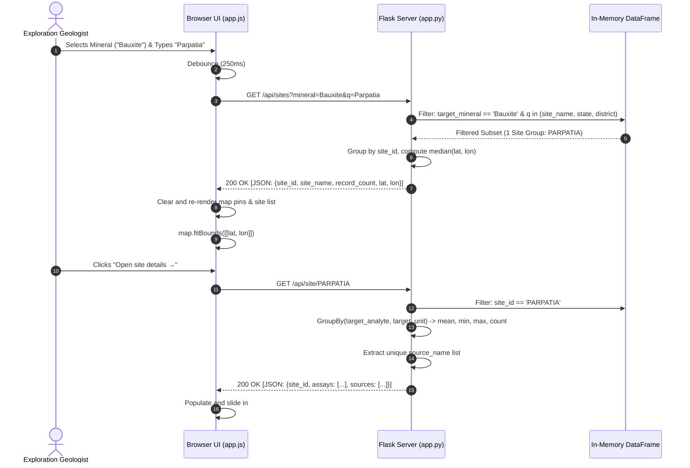

# GeoMine AI — System Architecture & Design Specification

> **Technical Architecture Document**  
> *Component interaction, spatial data indexing, geochemical summarization, and geospatial machine learning evaluation methodology.*

---

## 1. Architectural Overview

GeoMine AI is an exploration intelligence platform designed to ingest, normalize, and visualize subsurface assay data from Indian National Mineral Exploration Trust (NMET), Mineral Exploration Corporation Limited (MECL), Geological Survey of India (GSI), and State Mining Corporation reports (G2, G3, and G4 exploration stages).

The system decouples data ingestion and auditing from interactive client exploration through a lightweight, in-memory analytical Flask service and a Leaflet-powered GIS dashboard.

```mermaid
flowchart TD
    subgraph Ingestion["1. Data Ingestion & Preprocessing"]
        PDF["Unstructured Geological Reports (G2/G3/G4 PDFs)"] --> OCR["Tabular Extraction & Transcription"]
        OCR --> Coords["Coordinate Normalization (UTM / DMS → WGS84)"]
        Coords --> Audit["Data Quality & Rule Auditing (70 Flagged Records)"]
        Audit --> CSV[("GeoMineAI_Final_Model_Training_Clean_v1.csv<br/>32,562 Records · 22 Columns")]
    end

    subgraph Backend["2. Application & Query Layer (Flask)"]
        CSV --> InMem["In-Memory Pandas Analytical Engine"]
        InMem --> Filter["Spatial Filter & Full-Text Search Engine"]
        InMem --> Agg["On-Demand Assay Statistical Aggregator<br/>(Mean, Min, Max, Count)"]
        Filter --> Endpoints["REST API Endpoints (/api/*)"]
        Agg --> Endpoints
    end

    subgraph Frontend["3. Presentation Layer (Leaflet & Vanilla JS)"]
        Endpoints --> StateMgr["Client State Manager (app.js)"]
        StateMgr --> LeafletMap["Leaflet GIS Map Engine (OSM Tiles)"]
        StateMgr --> Console["Filter & Search Console"]
        StateMgr --> Drawer["Site Detail & Geochemical Assay Drawer"]
    end

    subgraph ML["4. Experimental ML Pipeline (Offline)"]
        CSV --> SpatialSplit["Spatial Cross-Validation (Leave-One-Site-Out)"]
        SpatialSplit --> Baseline["Mean Baseline Evaluator"]
        SpatialSplit --> Regressors["Tree-based Regressors (Bauxite Al₂O₃ Target)"]
        Baseline -.-> Compare{"Empirical Performance Audit"}
        Regressors -.-> Compare
    end

    style CSV fill:#101922,stroke:#42e5d1,stroke-width:2px,color:#e7f0f4
    style InMem fill:#13232c,stroke:#b7f36b,stroke-width:2px,color:#e7f0f4
    style Compare fill:#1c2d38,stroke:#ff9d57,stroke-width:2px,color:#e7f0f4
```



---

## 2. Component Design

### 2.1 Storage & Ingestion Layer
- **Input Artifact**: `data/GeoMineAI_Final_Model_Training_Clean_v1.csv` (16.5 MB, 32,562 records).
- **Format**: Flat tabular dataset with complete data lineage tracking (transcription provenance, source document file name, source table page number, coordinate derivation method, quality audit status, and model training weight).
- **Execution Model**: The dataset is parsed at server startup into memory via `pandas.read_csv()`. Numeric coercion is enforced on `latitude`, `longitude`, `target_value`, and `target_training_weight`. Invalid spatial bounds are pruned using the bounding envelope:
  $$\text{Latitude} \in [-90.0, 90.0], \quad \text{Longitude} \in [-180.0, 180.0]$$

### 2.2 Server & Analytical Core (Flask)
The backend does not require an external database engine for prototype scale:
1. **Startup Initialization**:
   - Single-pass verification of mandatory columns (`target_mineral`, `site_id`, `site_name`, `latitude`, `longitude`).
   - Global in-memory DataFrame storage (`df`), eliminating file I/O latency on incoming HTTP requests.
2. **Spatial Clustering & Deduplication**:
   - In exploration datasets, hundreds to thousands of borehole core samples share identical or localized borehole collar coordinates within an exploration block.
   - For map presentation, the server groups records by `site_id` and calculates the spatial centroid via median coordinate aggregation:
     $$\bar{\phi}_{\text{site}} = \text{median}(\phi_i), \quad \bar{\lambda}_{\text{site}} = \text{median}(\lambda_i) \quad \forall i \in \text{site}$$
   - This condenses 32,562 sample rows into 18 stable, distinct geographic pins, preventing map clustering lag.
3. **On-the-Fly Assay Aggregation**:
   - The `/api/site/<site_id>` endpoint groups all sample assays by `(target_analyte, target_unit)`.
   - Generates arithmetic summary statistics on valid numeric measurements:
     $$\mu = \frac{1}{N} \sum_{k=1}^N x_k, \quad \min(x), \quad \max(x), \quad N = \text{valid sample count}$$

### 2.3 Presentation Layer (Client GIS)
- **Zero-Build Architecture**: Implemented with standards-compliant HTML5, modular CSS3, and modern Vanilla ES6+ (`fetch`, `async/await`), requiring no Webpack, Vite, or npm build steps.
- **Geographic Projection**: Leaflet 1.9.4 rendering OpenStreetMap tiles under EPSG:3857 projection. Custom styled circular markers with pulsing cyan aesthetics matching the geological dark theme.
- **Reactive UI**: Debounced query console (250 ms delay) supporting compound filtering:
  - Target mineral category selection (dropdown).
  - Substring search across `site_name`, `state`, and `district`.
  - Dynamic map viewport re-centering (`map.fitBounds()`) based on currently visible site coordinates.
- **Detail Slide-Over Drawer**: Displays site coordinates, administrative metadata, up to 35 recorded geochemical analytes, and cited exploration report documents.

---

## 3. Data Flow & Request Lifecycle



---

## 4. Geospatial Machine Learning Architecture

### 4.1 Problem Formulation & Spatial Domain
The core machine learning objective explored in this repository is estimating subsurface elemental concentration (specifically grade prediction for **Bauxite $\text{Al}_2\text{O}_3$**) from geochemical indicators and spatial covariates.

$$\hat{y}_i = f(\mathbf{x}_i, \phi_i, \lambda_i, \mathbf{s}_i)$$

Where:
- $\hat{y}_i$: Predicted grade (e.g., $\% \text{Al}_2\text{O}_3$).
- $\mathbf{x}_i$: Co-occurring geochemical analytes ($\text{SiO}_2$, $\text{Fe}_2\text{O}_3$, $\text{TiO}_2$, $\text{LOI}$).
- $(\phi_i, \lambda_i)$: Geographic coordinates.
- $\mathbf{s}_i$: Site / geological domain identifiers.

### 4.2 Cross-Validation Strategy: Spatial Autocorrelation & LOSO
In geological machine learning, standard random $K$-fold cross-validation suffers from **severe spatial data leakage** due to Tobler's First Law of Geography: nearby samples from the same drill campaign share identical geological formations and analytical batches. Random splitting yields artificially inflated $R^2$ scores ($\approx 0.90+$) that collapse when tested in real-world unexplored blocks.

To combat this, the pipeline incorporates **Leave-One-Site-Out (LOSO)** cross-validation:

```
Fold 1: Train on [PARPATIA, DUMARGUDA]       -> Test on [TARHAPANI-WEST]
Fold 2: Train on [TARHAPANI-WEST, DUMARGUDA] -> Test on [PARPATIA]
Fold 3: Train on [PARPATIA, TARHAPANI-WEST] -> Test on [DUMARGUDA]
```

### 4.3 Baseline Audit & Empirical Finding
Under strict Leave-One-Site-Out spatial cross-validation, the initial Bauxite $\text{Al}_2\text{O}_3$ regression model **did not outperform an empirical mean baseline predictor**:

$$\text{Baseline: } \hat{y}_{\text{test}} = \frac{1}{N_{\text{train}}} \sum_{j \in \text{train}} y_j$$

- **Root Cause**: Geological bauxite profiles in Surguja (Chhattisgarh) and Koraput (Odisha) developed over distinct parent lithologies (Deccan trap basalt lateritization vs. Eastern Ghats charnockite/khondalite granulites). Without transferrable lithological and geophysical features, local spatial interpolators fail to generalize across basins.
- **Architectural Decision**: Consistent with professional engineering ethics, **model predictions are strictly retained as experimental research and are NOT served as live exploration guidance in the UI**. The user interface strictly visualizes empirical, source-traceable assay data.

---

## 5. Scalability & Production Evolution Roadmap

| Tier | Component | Current Prototype | Target Production Architecture |
|---|---|---|---|
| **Data Storage** | Dataset Engine | In-Memory CSV via Pandas (32K rows) | PostGIS on PostgreSQL + TimescaleDB for spatial indexing |
| **API Framework** | Web Server | Flask 3.1 (synchronous WSGI) | FastAPI + Pydantic v2 (asynchronous ASGI with automated OpenAPI docs) |
| **Spatial Indexing** | Query Resolution | Pandas boolean filtering & groupby | R-Tree / PostGIS `ST_DWithin` spatial bounding queries |
| **GIS Rendering** | Map Visualization | Leaflet.js DOM Marker Layer | Deck.gl / MapLibre GL for WebGL-accelerated 500k+ point rendering |
| **ML Inference** | Model Serving | Offline scikit-learn evaluation | ONNX Runtime microservice with spatial uncertainty intervals |
| **Containerization**| Deployment | Local python script execution | Multi-stage Docker container (`python:3.12-slim`) orchestrated with Helm/K8s |
